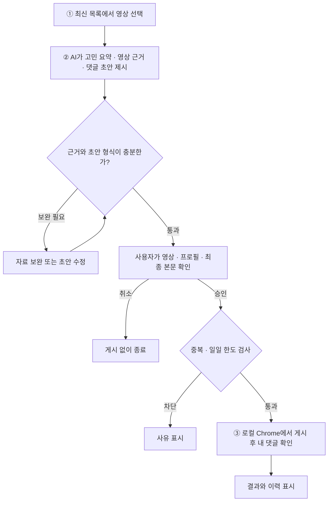

# YouTube Marketing AI Agent

유튜브 영상에서 다루는 연애 고민을 요약하고, 연애 사주 브랜드 ‘운명원’에 관한 댓글 초안을 검토하는 로컬 대시보드입니다.

예시 영상으로 승인 결과를 시연하거나, YouTube 검색으로 실제 영상의 설명과 공개 댓글을 조회할 수 있습니다. 확인한 영상 근거를 입력하면 AI 댓글 초안을 생성합니다.

## 핵심 워크플로우



AI는 접근 가능한 자막이나 영상 제목·설명, 공개 댓글을 참고해 **영상 속 구체적인 발언이나 장면에 근거한 40~120자 초안**을 제안합니다. 게시 한도는 영상당 한 건, 하루 기본 열 건입니다. 게시 후 내 댓글을 확인할 수 없으면 **확인 대기**로 남겨 자동 재게시를 막습니다. [상세 워크플로우](docs/CORE_WORKFLOW.md)

## 로컬에서 실행하기

Node.js LTS와 JDK 21을 준비하고 저장소 루트에서 터미널 두 개를 엽니다. 백엔드 터미널의 `JAVA_HOME`은 JDK 21 설치 경로로 설정합니다.

```powershell
# 터미널 1 — 백엔드
cd backend
.\gradlew.bat :api:bootRun
```

```powershell
# 터미널 2 — 프론트엔드
cd frontend
npm ci
npm run dev
```

Vite가 표시한 주소를 열면 API 키 없이 서버 연결 상태를 확인할 수 있습니다.

[개발 환경 가이드](docs/ENVIRONMENT_SETUP.md) · [아키텍처](docs/ARCHITECTURE.md) · [구현 현황](docs/TODO.md) · [과제 안내서](docs/track-2-marketing-agent.pdf)

## 백엔드 모듈과 API 키

- `backend/api`: Spring Boot 실행 서버, API와 작업 흐름 (`api → ai`)
- `backend/ai`: OpenAI Responses API 호출 클라이언트 (DB 의존 없음)
- `sql/`: 초기 스키마와 [DBeaver 조회 쿼리](sql/inspect-postgres.sql). JPA 엔티티와 저장소는 API 모듈에 포함됩니다.

`backend/.env.example`을 `backend/.env`로 복사한 뒤 `OPENAI_API_KEY=` 뒤에 키를 입력합니다. 따옴표 없이 작성하고 서버를 재시작하세요. `YOUTUBE_API_KEY`는 YouTube Data API v3를 활성화한 프로젝트의 키입니다. OS 환경 변수는 `.env`보다 우선합니다. 실제 `.env`는 Git에서 제외됩니다.

```powershell
cd backend
Copy-Item .env.example .env # 처음 한 번만 실행; 기존 .env가 있으면 덮어쓰지 마세요
.\gradlew.bat :api:bootRun
```

키가 없어도 예시 대시보드와 서버는 실행됩니다. 키를 추가하고 화면의 **AI 초안 생성·재생성**을 누르면 선택한 예시 영상의 제목·근거로 실제 AI 요청을 보냅니다. 생성 결과는 편집기에 반영되고 직접 수정할 수 있습니다. 생성 중 중복 요청을 막고, 실패하면 기존 초안을 유지합니다. 서버에서 40~120자·URL·해시태그 형식을 검사합니다. 영상 선택을 바꾸면 이전 요청 결과는 반영하지 않습니다. 시작 시 자동 AI 요청은 없습니다. 실제 영상은 **영상 작업실**에서 검색해 선택하세요. 서버가 영상별 요약과 초안을 생성하고 DB에 저장합니다. 같은 탭을 새로고침하면 진행 상태와 선택한 영상이 복원됩니다. 같은 영상을 다시 선택하면 기존 결과를 불러옵니다. 직접 편집한 근거와 초안은 해당 브라우저에 보관하며, 서버 재시작으로 중단된 생성은 화면에서 다시 시도할 수 있습니다.

빌드: `backend/`에서 `.\gradlew.bat :api:bootJar` (결과: `api/build/libs/`). JAR 직접 실행도 `backend/`를 작업 디렉터리로 사용하세요. 기존 H2 경로 `backend/data/marketing-agent`를 유지합니다.

연동 기준: [OpenAI 공식 API 문서](https://developers.openai.com/api/reference/overview), [Responses API 시작 가이드](https://developers.openai.com/api/docs/quickstart).

초안 API: `POST /api/analysis/draft`. JSON 요청은 `{"title":"영상 제목","evidence":"확인 가능한 근거"}`, 응답은 `{"draft":"생성된 댓글"}`입니다. 제목·근거 입력 오류는 400, 키 미설정·생성 형식 오류는 503, 외부 API 실패는 502를 반환합니다.


실제 영상을 선택한 뒤 **AI 고민 요약**을 누르면 영상 설명과 공개 댓글을 분석합니다. 요약과 함께 원문 인용 및 출처를 표시합니다. 자료가 부족하면 검토 안내가 표시됩니다. 댓글 초안에 사용할 영상 근거는 편집기에서 직접 확인하고 입력하세요.

실제 영상의 초안을 편집한 뒤 **작업 상태 → 이 본문으로 승인 저장**을 누르면 영상 ID, 프로필(유튜브 1), 최종 본문, 승인 시각을 로컬 H2에 저장합니다. 새로고침하거나 백엔드를 재시작한 뒤 같은 영상을 선택해 승인 본문과 시간순 이력을 확인하세요. 영상별 승인은 한 번이며, 전체 프로필을 합산해 한국 시간 기준 하루 10건까지 승인할 수 있습니다. 승인 후 **Chrome에서 댓글 입력창 확인**을 누르면 서버가 설치된 PC의 Chrome에서 영상을 엽니다. 최초에는 열린 창에서 YouTube에 로그인한 뒤 같은 버튼을 다시 누르세요. 로그인 정보는 사용자 홈의 `.clipdesk/chrome-profiles/youtube-1`에 보관합니다. Google이 자동화 창에서 로그인을 허용하지 않으면 해당 창을 닫고 일반 Chrome을 같은 `--user-data-dir`로 실행해 로그인한 후 종료하세요. 이 단계는 입력창 확인까지 진행합니다.

동시 승인 회귀 테스트는 backend 디렉터리에서 다음 명령으로 실행합니다.

```powershell
.\gradlew.bat :api:test --tests '*ApprovalConcurrencyTests'
```

## Docker DB와 IntelliJ 실행

Docker Desktop을 실행한 뒤 저장소 루트에서 다음 명령으로 PostgreSQL만 실행합니다.

~~~powershell
docker compose up -d db
docker compose ps
~~~

IntelliJ에서 MarketingAgentApplication의 Spring Boot 실행 구성을 만듭니다.
JDK는 21, 클래스패스 모듈은 backend.api.main, Working directory는 backend 디렉터리로 설정합니다.
Active profiles에 local을 입력합니다. Active profiles 항목이 없으면 VM options에 -Dspring.profiles.active=local을 추가합니다.
backend/.env의 API 키를 입력하고 Run을 누르세요.

DBeaver에서는 PostgreSQL 연결을 만들고 localhost:5432, Database marketing_agent, Username marketing, Password marketing_local을 입력합니다.
백엔드를 실행한 상태에서도 DB를 조회할 수 있습니다.
비밀번호는 로컬 개발용이며 compose.yaml과 application-local.properties가 동일해야 합니다.
기존 H2 데이터는 별도로 유지되고 PostgreSQL에는 새 데이터가 저장됩니다.

~~~powershell
docker compose stop db
~~~

위 명령은 DB만 종료하고 볼륨의 데이터를 유지합니다.


**AI 설정**에서 영상 분석과 초안 생성에 사용할 모델(GPT-6 Astra, GPT-6.1 Sol, GPT-5.4, GPT-5.4 mini, GPT-5.4 nano 중 선택, 기본값 GPT-5.4 mini)을 선택하고 댓글 초안의 말투와 강조할 내용을 수정할 수 있습니다. 저장한 지침은 생성·재생성할 때 적용됩니다. 백엔드를 재시작하면 초기 SQL이 `comment_prompt` 테이블을 준비하며, 기존 지침은 유지합니다. DBeaver에서는 `sql/inspect-postgres.sql`의 8번 쿼리로 현재 지침을 확인하세요.
