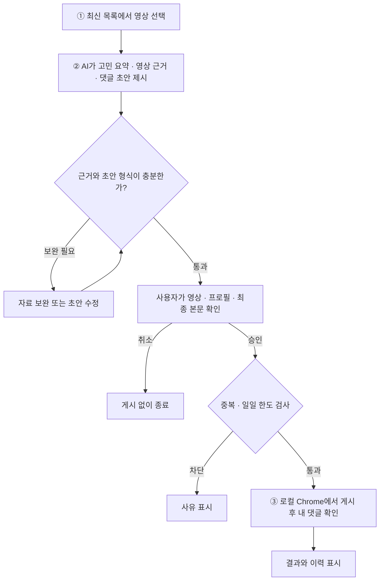

# YouTube Marketing AI Agent

유튜브 영상에서 다루는 연애 고민을 요약하고, 연애 사주 브랜드 ‘운명원’에 관한 댓글 초안을 검토하는 로컬 대시보드입니다.

**현재 구현 범위**는 예시 영상 3개로 선택·초안 편집·모의 승인 결과를 확인하고, 예시 근거를 바탕으로 실제 AI 댓글 초안을 생성하는 대시보드입니다. 실제 YouTube 데이터 조회, AI 고민 요약·근거 추출, Chrome 게시는 후속 구현 범위입니다.

## 핵심 워크플로우



AI는 접근 가능한 자막이나 영상 제목·설명, 공개 댓글을 참고해 **영상 속 구체적인 발언이나 장면에 근거한 40~120자 초안**을 제안합니다. 게시 한도는 영상당 한 건, 하루 기본 열 건입니다. 게시 후 내 댓글을 확인할 수 없으면 **확인 대기**로 남겨 자동 재게시를 막습니다. [상세 워크플로우](docs/CORE_WORKFLOW.md)

## 로컬에서 실행하기

Node.js LTS와 JDK 21을 준비하고 저장소 루트에서 터미널 두 개를 엽니다. 백엔드 터미널의 `JAVA_HOME`은 JDK 21 설치 경로로 설정합니다.

```powershell
# 터미널 1 — 백엔드
cd backend
.\gradlew.bat :api:bootRun
```

```powershell
# 터미널 2 — 프론트엔드
cd frontend
npm ci
npm run dev
```

Vite가 표시한 주소를 열면 API 키 없이 서버 연결 상태를 확인할 수 있습니다.

[개발 환경 가이드](docs/ENVIRONMENT_SETUP.md) · [아키텍처](docs/ARCHITECTURE.md) · [구현 현황](docs/TODO.md) · [과제 안내서](docs/track-2-marketing-agent.pdf)

## 백엔드 모듈과 API 키

- `backend/api`: Spring Boot 실행 서버, API와 작업 흐름 (`api → ai`, `api → db`)
- `backend/ai`: OpenAI Responses API 호출 클라이언트 (DB 의존 없음)
- `backend/db`: JPA 엔티티와 초기 SQL

`backend/.env.example`을 `backend/.env`로 복사한 뒤 `OPENAI_API_KEY=` 뒤에 키를 입력합니다. 따옴표 없이 작성하고 서버를 재시작하세요. `OPENAI_MODEL`로 모델을 변경할 수 있으며, `YOUTUBE_API_KEY`는 향후 YouTube 연동을 위한 설정입니다. OS 환경 변수는 `.env`보다 우선합니다. 실제 `.env`는 Git에서 제외됩니다.

```powershell
cd backend
Copy-Item .env.example .env # 처음 한 번만 실행; 기존 .env가 있으면 덮어쓰지 마세요
.\gradlew.bat :api:bootRun
```

키가 없어도 예시 대시보드와 서버는 실행됩니다. 키를 추가하고 화면의 **AI 초안 생성·재생성**을 누르면 선택한 예시 영상의 제목·근거로 실제 AI 요청을 보냅니다. 생성 결과는 편집기에 반영되고 직접 수정할 수 있습니다. 생성 중 중복 요청을 막고, 실패하면 기존 초안을 유지합니다. 서버에서 40~120자·URL·해시태그 형식을 검사합니다. 영상 선택을 바꾸면 이전 요청 결과는 반영하지 않습니다. 시작 시 자동 AI 요청은 없습니다. 요약·근거와 승인 결과는 여전히 예시이며, 실제 영상 조회나 게시는 수행하지 않습니다.

빌드: `backend/`에서 `.\gradlew.bat :api:bootJar` (결과: `api/build/libs/`). JAR 직접 실행도 `backend/`를 작업 디렉터리로 사용하세요. 기존 H2 경로 `backend/data/marketing-agent`를 유지합니다.

연동 기준: [OpenAI 공식 API 문서](https://developers.openai.com/api/reference/overview), [Responses API 시작 가이드](https://developers.openai.com/api/docs/quickstart).

초안 API: `POST /api/analysis/draft`. JSON 요청은 `{"title":"영상 제목","evidence":"확인 가능한 근거"}`, 응답은 `{"draft":"생성된 댓글"}`입니다. 제목·근거 입력 오류는 400, 키 미설정·생성 형식 오류는 503, 외부 API 실패는 502를 반환합니다.
