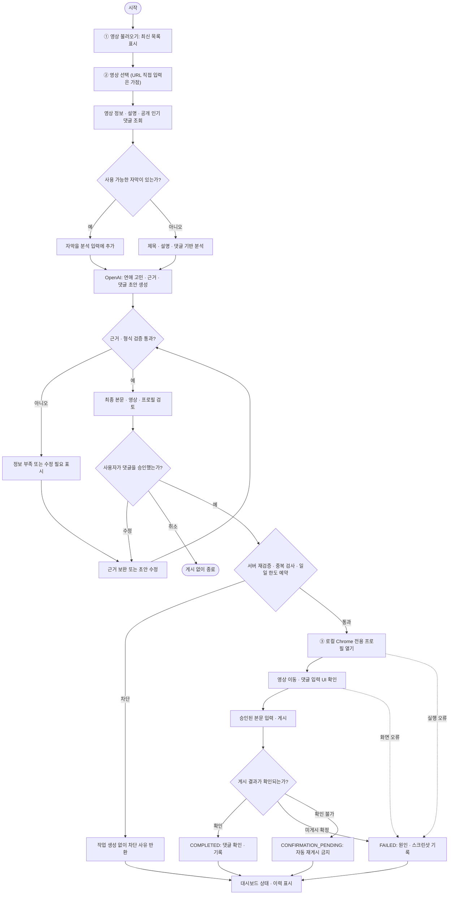
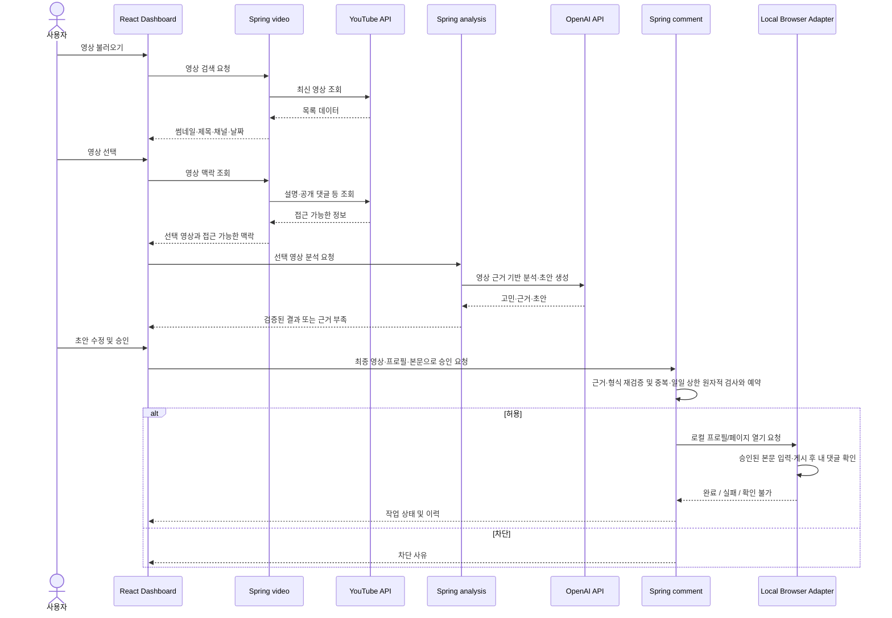
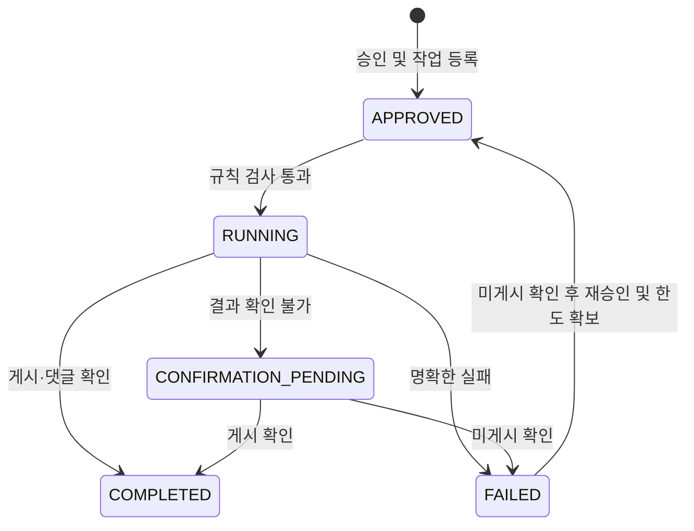

# 핵심 기능 워크플로우 — Marketing AI Agent

> 목적: TRACK 2 과제의 3단 대시보드 사용자 흐름과 프론트엔드·백엔드의 책임을 명확히 한다.
> 기준: `track-2-marketing-agent.pdf` 및 현재 합의한 `React + Spring Boot` 단일 백엔드 아키텍처.
> 상태: **설계 초안**. 로컬 H2·JPA와 초기 SQL은 구성됐다. 아래 사용자 흐름은 후속 구현 범위이며 Docker와 Chrome 연동 방식은 미정이다.

## 1. 핵심 사용자 워크플로우

### 검증 규칙

- AI 초안: **40~120자**, 영상별로 다르게, 확인된 구체적인 장면 또는 발언을 최소 하나 반영한다.
- 금지: 링크, 해시태그, 직접 이용하지 않은 **운명원** 후기 조작. 확인되지 않은 영상 내용을 지어내지 않는다.
- 정보가 부족해 구체적인 근거를 확보할 수 없으면 **근거 부족** 상태로 표시하고, 자동으로 게시 가능 상태로 진행시키지 않는다.
- 영상별 **1개**의 댓글 게시, **일일 기본 최대 10건** 제한. 성공 여부가 불명확할 때는 재시도 전에 사람의 확인이 필요하다.
- 게시·프로필 사용은 **사용자 검토 및 명시적 승인**을 전제로 하고, 본인이 관리하거나 허가받은 테스트 환경에서 검증한다. 다중 계정 반복 홍보와 기만적 시청자 사칭을 자동화하지 않는다.

## 2. 프론트엔드 ↔ 백엔드 흐름

> 위 다이어그램은 **논리적 상호작용**을 표현한다. 영상 맥락의 `video → analysis` 전달 방식과 브라우저의 프로세스 간 연결 방식 등은 구현 단계에서 결정한다.

## 3. 최소 작업 상태

초안 작성·검토와 요청 차단은 UI 단계 또는 요청 결과다. DB 작업은 승인과 한도 확보 후 `APPROVED`부터 기록한다. 재시도는 같은 영상의 기존 작업을 사용한다. 상태와 이력은 한 트랜잭션으로 갱신한다.

- **RUNNING:** 로컬 브라우저 작업 진행 중. 화면 상태(프로필 열기·입력 중 등)는 세부 이벤트로 기록한다.
- **COMPLETED:** 화면에서 본인 댓글 확인까지 완료.
- **FAILED:** 명확한 오류 원인과 가능하면 스크린샷을 남긴다.
- **CONFIRMATION_PENDING:** 게시 성공 여부를 확인하지 못한 상태. 자동 재게시하지 않는다.

## 4. 책임 경계

| 영역 | 책임 |
| --- | --- |
| `frontend/src/features/video` | 영상 목록, 선택, 검색 UI |
| `frontend/src/features/analysis` | 고민·근거·초안 표시, 수정·검토 |
| `frontend/src/features/comment` | 승인, 작업 상태, 이력 UI |
| `backend/video` | 영상 검색, 접근 가능한 맥락 수집 및 정규화 |
| `backend/analysis` | OpenAI 호출, 근거 확인, 초안 규칙 검증 |
| `backend/comment` | 중복·일일 한도, 승인 상태, 작업 이력, 결과 정합성 |
| `browser adapter` | 로컬 브라우저 실행/상태 확인. 실행 위치는 별도 기술 검증 필요 |

## 5. 후속 결정 사항

- STEP 4에서 일일 상한의 날짜 기준과 예약·해제 트랜잭션을 결정한다. 9건 사용 시 동시 요청 두 건 중 하나만 게시 단계에 진입해야 한다.
- Chrome 연결: 로컬 Spring Boot 프로세스와 OS별 Chrome 프로필/Playwright 연동 가능성 검증.
- 자막 접근: 모든 공개 영상의 자막이 YouTube Data API로 제공된다고 가정하지 않음.
- 작업 상태 전파: 초기 폴링 vs SSE (요구가 생기면 결정).
- API 명세와 추가 저장 필드는 화면 계약에 따라 결정한다. 현재 기준은 [작업 상태](../backend/api/src/main/java/com/marketing/agent/db/entity/JobStatus.java)와 [초기 SQL](../sql/schema.sql)이다.

## 6. 완료 기준 (설계 검토)

- [ ] 3단 UI의 각 버튼에 대응하는 요청·결과·실패 흐름이 설명된다.
- [ ] AI 결과 검증과 사용자의 최종 승인 지점이 구분된다.
- [ ] 영상당 1개 및 하루 10건 제한이 작업 실행 전에 검사된다.
- [ ] 실제 게시 확인 실패 시 `CONFIRMATION_PENDING`으로 분기하고 중복 재게시를 막는다.
- [ ] 등록된 작업의 상태 변경은 이력으로 남고, 등록 전 차단 사유는 UI에서 확인된다.
- [ ] 미확정 인프라 선택을 구현이 이미 확정된 것처럼 표현하지 않는다.
